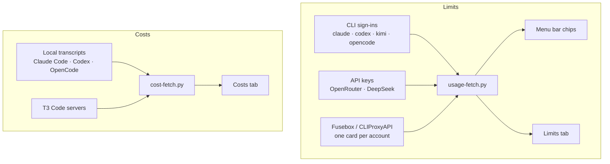

<div align="center">

# Quotatank

**Every AI coding limit you pay for, in the Omarchy menu bar: how much is left, when it comes back, and how long it lasts at your pace.**

[](https://github.com/JanitorHead/omarchy-quotatank/releases) [](LICENSE)

[Install](#install) · [Limits and pace](#limits-and-pace) · [Balances](#balances-not-just-percentages) · [Menu bar](#menu-bar) · [Accounts](#one-card-per-account) · [Costs](#costs) · [Settings](#settings-that-apply-as-you-go)

</div>


Quotatank reads the plan limits of **Claude Code, OpenAI Codex, Kimi Code, and OpenCode Go** from the CLIs you already signed in with, the prepaid balances of **OpenRouter and DeepSeek** from an API key, or every account behind a **Fusebox or CLIProxyAPI** server. A second tab estimates what your recorded tokens would cost at API rates.

<sub>Screenshots use fixture data in the Tokyo Night theme unless noted.</sub>

## Why it is different

- **A run-out time, not just a percentage.** Each limit card projects from your recent rate: `Runs out in 1h 9m` when the limit would empty before it resets, `Lasts until reset` when it would not. One headline above the cards gives the answer for the whole provider.
- **A pace tick on the meter.** A tick marks where even use would have put you by now; blocks past it are use ahead of pace, and a badge counts the points ahead or behind.
- **Money where money is the limit.** OpenRouter and DeepSeek lead with what you can still spend, in their own currency, with low-balance alerts in amounts rather than percentages.
- **Two limits and their reset times in each chip.** Stack a second limit under the first, show when each one resets, or hide a provider from the bar while its weekly limit is used up.
- **Settings that apply as you make them.** No Save button: flip a switch and watch the bar change, then flip it back.
- **Alerts that re-arm.** A desktop notification fires when a limit or a balance crosses your warning or critical threshold, and again after it recovers or resets.
- **Private by default.** Accounts appear as Account 1, Account 2, and so on. Keys and tokens stay in private files, never in widget settings.

## Install

```bash
omarchy plugin add https://github.com/JanitorHead/omarchy-quotatank.git --enable
```

Then [connect a source](#connect-a-source). To update or remove:

```bash
omarchy plugin update janitorhead.quotatank
omarchy plugin remove janitorhead.quotatank
```

The built-in `omarchy.agents` widget can run alongside Quotatank. To keep only Quotatank, run `omarchy plugin disable omarchy.agents`. To put the chips somewhere else in the bar, use `omarchy bar move janitorhead.quotatank left`.

<details>
<summary>Requirements</summary>

- Omarchy with schema-v1 shell plugins.
- Python 3.10 or newer. The quota and cost backends use only the standard library.
- Network access for quota checks. Costs can download the public LiteLLM price table and contact the T3 servers you configure.
- Optional: Python `websockets` 15 or newer, for live account activity from Fusebox.

</details>

## Limits and pace


The tick marks where even use would be by now, so blocks past it are use ahead of pace. The status line projects from the recent rate, which weighs the newest samples most (a two-hour half-life), so use from days earlier does not count. Here the limit runs out in 1h 9m, before its window resets in 2h 4m. Cards are ordered shortest window first, and every provider names its windows the same way: `5-hour limit`, `Weekly limit`, `Monthly limit`.

<details>
<summary>Every status line</summary>

| Status line | Meaning |
|---|---|
| `Runs out in 1h 9m · pace 58%` | At the recent rate, the limit empties before the window resets |
| `Lasts until reset · pace 55%` | At the recent rate, the limit lasts until the window resets |
| `Idle 1h 2m · pace 40%` | Usage has not risen for an hour, so no projection is made |
| `Collecting data` | Less than ten minutes of samples so far |
| `No recent data` | The newest sample is more than an hour old |
| `Pace starts after 2% of the window` | Less than 2% of the window has passed |
| `No usage yet` | Nothing has been used in this window |
| `Limit reached` | The limit is 100% used |
| `No pace for this limit` | The provider reports no window length or reset time |

</details>


**Show limits as** flips every card, chip, and balance between used and left; **Providers → Customize** reads a single provider the other way. The meter, the tick, and the pace share follow the setting. Warning and critical thresholds are stored as percent left, 25% and 10% by default, so the Opus limit is critical at 9% left whichever way you read it.


When something is wrong, the panel says what and what to do: a used-up limit names when it comes back, a failed refresh names the command to run, and a drained balance says it needs topping up. The chip in the bar shows a short reason instead of a figure (`sign in`, `rate limited`, `offline`), and hovering it gives the full message.

## Balances, not just percentages


OpenRouter and DeepSeek are prepaid, so their figure is money: what the account can still spend, which for OpenRouter is the lowest of the balance and every spending limit's allowance. The headline adds how long it lasts at this week's rate (`$74.00 left · lasts about 8 weeks`), OpenRouter's limits that reset become ordinary limit cards with a pace, and a CNY-only DeepSeek account shows yuan. **Low balance** alerts are amounts in the balance's currency, `5` and `1` by default.

## Menu bar


- **Limit shown** picks the window every chip shows. The default is each provider's most constrained limit; 5-hour, 7-day, and monthly pin one window. Every line is tagged with the period of the limit it shows (`7d 91%`), so the tag never lies about what is behind the number.
- **Second limit below** stacks a second limit under the first.
- **Show when limits reset** appends when each line resets: a time for limits that reset within a day, a date for weekly and monthly ones, in the formats you choose.
- **Hide providers that are used up** takes a provider out of the bar while one of its weekly or monthly limits is used up; it returns when the limit resets, and Limits keeps showing it.
- **Provider colors** paints each chip and limit meter in the provider's brand color.

Money providers lead with their balance and stack their tightest limit below. Clicking a chip opens that provider.

A chip switches to the Omarchy theme's alert color when either of its lines is at warning or critical, and keeps it with provider colors on, so a brand color never hides an alert. Quotatank has no red of its own: the color comes from the theme.

## One card per account


With Fusebox or CLIProxyAPI as the source, every managed account gets its own card with its own plan, percentage, and reset time. Each card shows the account's weekly limit when it reports one; **Additional limits** opens the others.

In CLIProxyAPI mode, Codex cards show how many banked resets the account holds. A banked reset resets that account's current Codex usage limits and is spent once applied, so clicking a nonzero badge opens a confirmation first. It lists each reset with its expiry, selects the one expiring soonest, and applies nothing until you choose **Apply reset**.

## Follows your theme


Colors and control borders come from the active Omarchy theme and change with it; text uses your Omarchy font, and every provider mark is the real brand mark at one size. Cards are square by default; turn off **Square cards** to follow the theme's corners.

## Costs


Costs estimates what your recorded tokens would cost at API rates. It is not a bill, a subscription charge, or a credit balance. Pick 24 hours, 7 days, or 30 days.

## Tokens

The Tokens tab shows the same period in token units: the headline total with a by-day chart and per-provider box, a six-tile summary (tokens, output, estimated cost, sessions, cache hit, active days), the full model breakdown, per-project tokens, and top sessions with titles. Project and session dropdowns start collapsed; every dropdown remembers its open state.

Local Claude Code and Codex history are on by default, OpenCode can be added, and up to four T3 Code servers bring in history from other computers. Prices come from the public LiteLLM table. Under **Custom prices**, set input, output, and optional cache prices in USD per million tokens for an exact model ID.

## Settings that apply as you go


The gear opens an index of six pages, and each row already says what the page is set to. There is no Save button: every switch, selector, and valid number applies the moment it changes, so you can compare the bar with the setting still in front of you. Keys and tokens are the exception, with an explicit **Save** that writes a private file, after which the page shows **Replace** and **Remove**.

| Page | What lives there |
|---|---|
| **Providers** | The source (local sign-ins or a Fusebox / CLIProxyAPI server), one row per provider with ▲ ▼ to set the order tiles and chips follow, **Monitor** and **Menu bar** switches, the API key editor under OpenRouter and DeepSeek, and **Customize** under each provider to override the defaults for that one: read it as used or left, pin the limit its chip shows and the second one below |
| **Menu bar** | Chips or the widget icon, the limit each chip shows, a second limit, reset times and formats, hiding used-up providers |
| **Alerts** | Desktop notifications, the percentage thresholds, and the low-balance amounts |
| **Display** | Used or left, provider colors, square cards, hidden account emails |
| **Costs** | Local history, T3 servers, custom prices, and the last scan |
| **Advanced** | Refresh interval (1 to 60 minutes) and diagnostics |

Every key is listed in the [settings reference](https://github.com/JanitorHead/omarchy-quotatank/blob/main/docs/configuration.md#settings).

Privacy:

- Quotatank reads existing CLI sign-ins and does not write authentication state. Quota checks are read-only.
- Applying a banked Codex reset is a separate action in CLIProxyAPI mode, and it asks for confirmation first.
- API keys, management keys, and T3 tokens are saved in private files (`0600`, in a `0700` directory), never in widget settings or command-line arguments. **Remove** deletes the file.
- Cost history stores token counts, timestamps, model names, and hashed transcript identifiers. It never stores prompts, responses, or tool output.
- HTTPS certificates are verified, and redirects are rejected.

## Connect a source

Limits and Costs have separate sources. A proxy can supply Limits while local transcripts supply Costs.



### Local CLI sign-ins

Sign in with each provider's CLI. Then open **Settings → Providers**, keep **Local sign-ins** as the source, and turn on **Monitor** for the providers you use.

| Provider | Connect with | Read from |
|---|---|---|
| Claude Code | `claude auth login` | Claude OAuth usage endpoint |
| OpenAI Codex | `codex login` | Codex app-server rate-limit RPC |
| Kimi Code | `kimi login` | Kimi usage endpoint |
| OpenCode Go | `opencode auth login` | OpenCode Go usage endpoint, using `OPENCODE_GO_API_KEY` or the key the OpenCode CLI stored |
| OpenRouter | An API key saved under its switch, or `OPENROUTER_API_KEY` | `GET /api/v1/key` and `GET /api/v1/credits`: the key's limits, the balance, and spend |
| DeepSeek | An API key saved under its switch, or `DEEPSEEK_API_KEY` | `GET /user/balance`: the platform balance per currency |

Quotatank reads existing CLI credentials and does not write authentication state. Sign-in stays with the CLI. See the [configuration reference](https://github.com/JanitorHead/omarchy-quotatank/blob/main/docs/configuration.md#providers-and-authentication) for details.

### Fusebox or CLIProxyAPI

1. Open **Settings → Providers** and choose **Fusebox / CLIProxyAPI** under **Source**.
2. Enter the server URL, for example `http://127.0.0.1:8317`, and leave the field.
3. Enter the Management API key that the server's management panel accepts and press **Save**. Client API keys and bcrypt hashes do not work.
4. Managed accounts are discovered automatically, one card each.

The key is saved to a private file (`0600`) and is never loaded back into the form. Remote servers must allow remote management. Quota lookups cover Claude, Codex, Kimi, and Antigravity accounts; other providers show an unsupported notice.

For CLIProxyAPI, the optional CPA Usage Keeper adds the last-used account to the menu bar. See the [account activity guide](https://github.com/JanitorHead/omarchy-quotatank/blob/main/docs/keeper-deployment.md).

### Cost history

Open **Settings → Costs**. Local Codex CLI and Claude Code history are on by default. Add up to four T3 Code servers, each with a name, base URL, and connection token. Servers must use usage contract version 4 or 5. Custom model prices are set on the same page, by exact model ID.

## Controls

| Action | Control |
|---|---|
| Open or close the panel | Left click on the bar |
| Next provider | Middle click on the bar, or `p` on Limits |
| Switch tabs | `u` for Limits, `c` for Costs, `t` for Tokens |
| Refresh | `r` |
| Costs metric | `m` |
| Token details, model breakdown | `d`, `b` on Tokens |
| Settings | `s` |
| Back to the settings index, then close | Escape |

Scripts and keybindings can use the shell IPC:

```bash
omarchy-shell janitorhead.quotatank limits
omarchy-shell janitorhead.quotatank costs
omarchy-shell janitorhead.quotatank tokens
omarchy-shell janitorhead.quotatank refresh
```

The other commands are `open`, `close`, `toggle`, `show`, `hide`, `next`, `configure`, `configureCosts`, and `exportJson`. While hide-emails is on, `exportJson` writes numbered account labels instead of identities.

## Documentation

- [Configuration and troubleshooting](https://github.com/JanitorHead/omarchy-quotatank/blob/main/docs/configuration.md)
- [Quota contract](https://github.com/JanitorHead/omarchy-quotatank/blob/main/docs/backend-contract.md) and [cost contract](https://github.com/JanitorHead/omarchy-quotatank/blob/main/docs/cost-contract.md)
- [Development](https://github.com/JanitorHead/omarchy-quotatank/blob/main/docs/development.md), [changelog](https://github.com/JanitorHead/omarchy-quotatank/blob/main/CHANGELOG.md), and [security policy](https://github.com/JanitorHead/omarchy-quotatank/blob/main/SECURITY.md)

## Credits and license

Quotatank is a derived work of [omarchy-modelusage](https://github.com/DigitalPals/omarchy-modelusage) by DigitalPals, released under the MIT license. Quotatank is MIT licensed too. See [LICENSE](LICENSE) and [THIRD_PARTY_NOTICES.md](THIRD_PARTY_NOTICES.md). Provider names and marks belong to their owners and do not imply endorsement.
